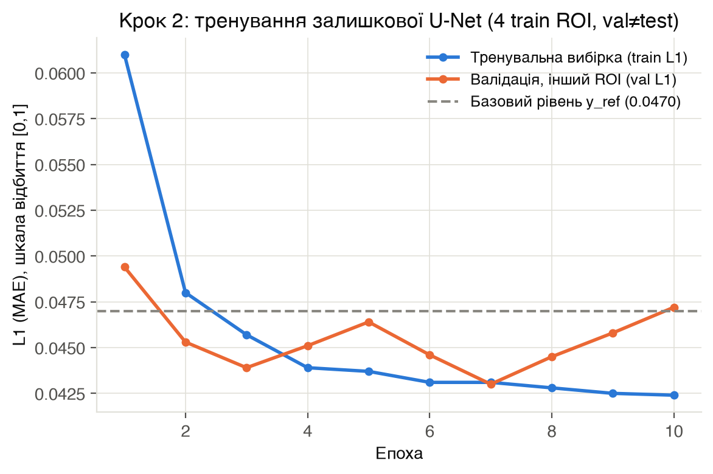
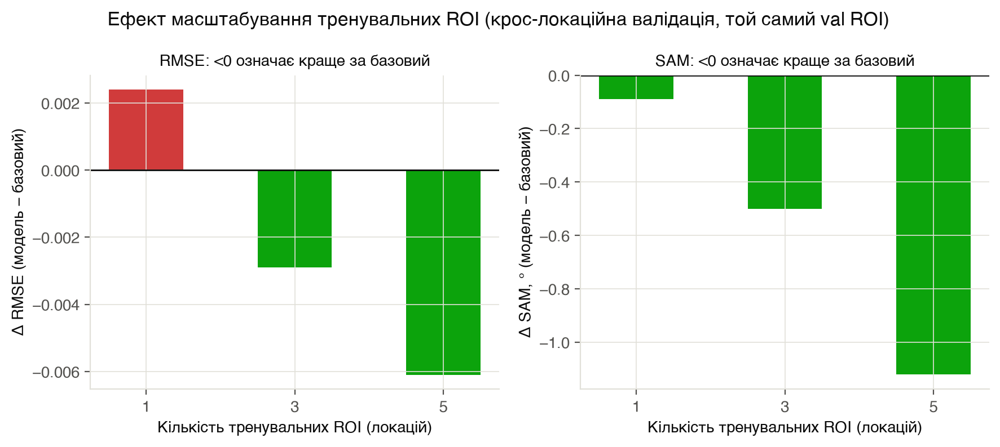
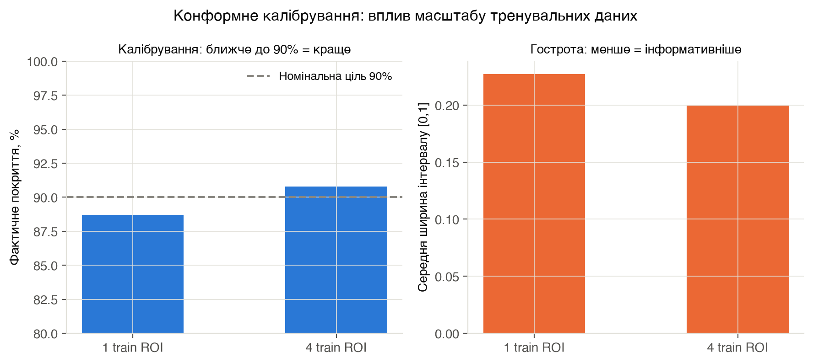
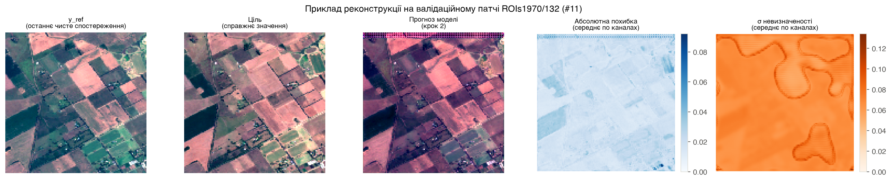

# Звіт: прототипування кроків 1-2 дисертаційного дослідження

**Тема:** інформаційна технологія безперервного оцінювання стану сільськогосподарських
культур за умов тривалої хмарності на основі фенологічно та агрометеорологічно
обмежених нейромережевих моделей мультимодальних даних ДЗЗ.

**Період робіт:** 2026-10-09 - 2026-10-10. **Репозиторій:** [github.com/yankee-dail/dissertation-ndvi](https://github.com/yankee-dail/dissertation-ndvi) (приватний).

**Статус у цілому:** працюючий, відтворюваний прототип конвеєра від сирих даних до
навченої моделі з оцінкою невизначеності. Усі числа нижче - з реальних даних
SEN12MS-CR-TS (не синтетика), але на малому масштабі (CPU, кілька ROI, 128x128,
10 епох, 1 запуск) - це демонстрація методології й перших сигналів, НЕ дисертаційний
результат.

---

## 0. Виправлення за результатами незалежної перевірки (2026-10-10)

Перша версія цього звіту містила методологічні недоліки, знайдені під час рецензування.
Вони виправлені в коді (не лише в тексті), і всі числа нижче - вже перераховані:

1. **Вибір чекпоінту й фінальний звіт рахувались на одному ROI** (val=test) - давало
   оптимістичний зсув. **Виправлено:** `train_step2.py` тепер приймає окремі
   `--val-roi` (вибір епохи) і `--test-roi` (фінальний звіт) - завжди різні ROI.
2. **Хмарні пікселі цілі не маскувались у метриках** - `target_max_cloud` обмежує лише
   СЕРЕДНЮ хмарність патча, окремі пікселі могли лишатись хмарними, і RMSE/MAE/SAM
   рахувались по них нарівні з чистими. **Виправлено:** `eval_protocol.py` тепер
   приймає маску й виключає пікселі з хмарністю ≥0.2 (SSIM лишається без маски -
   віконна метрика, маскувати коректно неможливо без зміни бібліотеки).
3. **"1→1 ROI, найкращий чекпоінт" подавався як "нічия"** - насправді ΔRMSE там
   статистично значуще ГІРШЕ (CI [+0.0010, +0.0039] не містить нуля), нічия лише за SAM.
4. **"Вдвічі вужчі інтервали" було перебільшенням** - фактично −43% (0.3710→0.2126),
   коефіцієнт ~1.75×, не 2×.
5. **ΔSAM для "1 ROI, блочний поділ"** перетинає нуль (CI [−3.22, +0.96]) - це НЕ значущий
   результат, і раніше він помилково позначався як підтверджений виграш поряд з RMSE.
6. **Висновок "різноманітність даних важливіша за архітектуру" був непідтверджений** -
   архітектура в цьому циклі робіт не варіювалась, а обсяг даних і склад територій
   змінювались одночасно (фактори сплутані). Твердження знято, замінено на обережніше.
7. **Довірчі інтервали відображають лише розкид між тестовими патчами в межах ОДНОГО
   запуску**, не розкид між повторними тренуваннями - це тепер явно проговорено в
   кожному звіті скрипта.
8. **"σ не корелює з похибкою" перевірено кількісно** (раніше - лише візуальне враження
   з одного патча): Pearson r=0.31, Spearman ρ=0.32 на 54,7 млн пікселях тесту,
   монотонний тренд по децилях (0.017→0.062, ×3.6). Це спростовує тезу "не корелює" -
   кореляція помірна, але реальна й статистично явна при такому n.

Усі "фінальні" результати нижче (§3, §4) - з перерахованих прогонів
(`results/step2_final/`, `results/uncertainty_final/`) з новою методологією.
Розвідувальні прогони з 1/3 ROI (стара методологія, val=test) лишені в таблиці
кроку 2 для прозорості еволюції роботи, але явно позначені як такі.

**Друге коло виправлень (та сама дата):**

9. **"−9,7%" у §3 було застарілим числом** з попередньої версії таблиці (0.0566/0.0627).
   Для актуальних 0.0504/0.0563 правильне значення **−10,5%**. Виправлено.
10. **calib ROI відрізнявся між рядками "1 ROI" і "4 ROI" у таблиці §4** (139 проти 140) -
    порівняння ширини інтервалу було нечесним (частина "виграшу" могла бути ефектом
    іншого calib ROI, не обсягу тренувальних даних). **Виправлено:** перерахував
    "1 ROI" з тим самим calib=asiaEast/139, що й у фінальному прогоні.
11. **Точки "1 ROI" і "3 ROI" у таблиці й рис. 2 (§3) використовували стару методологію**
    (val=test, без маски) - непорівнянно з фінальною точкою "4 ROI". **Виправлено:**
    перерахував обидві з тим самим val≠test поділом і маскуванням, що й фінал
    (`results/step2_1roi_v2/`, `results/step2_3roi_v2/`) - тепер усі три точки на
    рис. 2 отримані однаковою методологією.

---

## 1. Дані

Джерело: [SEN12MS-CR-TS](https://github.com/PatrickTUM/SEN12MS-CR-TS) (Ebel et al., 2022,
IEEE TGRS), офіційний тестовий спліт, завантажено напряму з MediaTUM TUM (FTP, з
перевіркою SHA512 на кожен архів).

| Регіон | Розмір (стиснено) | ROI | Патчів |
|---|---|---|---|
| asiaWest | 5,5 ГБ | ROIs1868/100 | 300 (використано для кроку 1 і першого прототипу кроку 2; дані згодом видалені для звільнення диска) |
| america | 10,9 ГБ | ROIs1158/106, ROIs1970/132 | 238, 270 |
| africa | 11,0 ГБ | ROIs2017/32, ROIs2017/140 | 238, 270 |
| asiaEast | 16,6 ГБ | ROIs1868/73, ROIs1868/119, ROIs1970/139 | 240, 300, 270 |

**Фінальний розподіл ролей ROI** (§3-§4, без перетину між групами):
- **train** (4 ROI, 986 патчів): america/106, africa/32, africa/140, asiaEast/73
- **val** - лише вибір епохи кроку 2 (1 ROI, 300 патчів): asiaEast/119
- **calib** - лише підбір q для методу 2 (1 ROI, 270 патчів): asiaEast/139
- **test** - лише фінальний звіт, обох кроків (1 ROI, 270 патчів): america/132

Локальний диск: регіони розпаковуються по одному, `.tar.gz` видаляється одразу
після успішної перевірки чексуми й розпакування - повний набір одночасно на диску
не вміщався б на цій машині (233 ГБ диска).

**AllClear** (NeurIPS 2024, [allclear.cs.cornell.edu](https://allclear.cs.cornell.edu/))
розглянуто як альтернативне/додаткове джерело (4 млн зображень, 23 742 ROI), але не
використано в цьому циклі робіт - весь прототип побудовано на SEN12MS-CR-TS.

---

## 2. Крок 1: чесна база (`scripts/eval_protocol.py`, `scripts/sen12mscrts_to_npz.py`)

**Мета:** перевірити, наскільки завищені базові методи реконструкції в літературі
через потрапляння кадру-цілі у вхід.

**Ключове методологічне рішення:** в офіційному завантажувачі SEN12MS-CR-TS
(`sample_type='cloudy_cloudfree'`, параметри за замовчуванням) ціль визначається як
`argmin(хмарність)` - найчистіший кадр серії. Це робить порівняння тавтологічним:
"найчистіший кадр" як базовий метод прогнозує саму ціль. Експортер тому обирає ціль
режимом `random_clean` - випадковий достатньо чистий кадр, **незалежний** від
глобального мінімуму хмарності.

**Результат (30 патчів, ROIs1868/100; хмарні пікселі цілі замасковано):**

| Метод | RMSE | SAM |
|---|---|---|
| least_cloudy_raw (найчистіший кадр, можливий витік) | 0.0545±0.0384 | 11.46°±6.23° |
| least_cloudy_strict (те саме, ціль явно виключена) | 0.0591±0.0343 | 12.43°±5.06° |
| linear_interp (потрапіксельна інтерполяція в часі) | 0.0551±0.0411 | 9.34°±4.42° |

Ризик витоку цілі у вхід: **10% (3/30)** на цьому зрізі - реальний, але не 100%, як
було б при тавтологічному визначенні цілі. Парний bootstrap не показав статистично
значущої різниці між методами на n=30 (CI перекривають нуль) - очікувано для такого
малого n.

---

## 3. Крок 2: залишкова U-Net (`scripts/model.py`, `scripts/train_step2.py`)

**Модель:** ŷ = y_ref + Δθ(x), де y_ref - найчистіший кадр СЕРЕД ПОПЕРЕДНІХ у часі
(причинний базовий рівень), x - конкатенація [y_ref, найближчий у часі кадр, його
хмарність, часовий зсув]. Невеликий U-Net (24-48-96 каналів, 2 рівні), простий L1-лосс
(НЕ маскований - модель тренується на повній цілі, маскування застосовується лише
при оцінці), навчання на CPU (Intel i7, без GPU).

**Базовий рівень для порівняння:** Δ=0, тобто просто скопіювати y_ref - структурний
аналог `least_cloudy_strict`/`linear_interp` з кроку 1.

### Еволюція результату (критична частина роботи)

Спершу - розвідувальні прогони зі старою методологією (val=test, без маски хмарних
пікселів цілі), що й виявили проблему:

| Прогін | Методологія | ΔRMSE (модель−базовий) | ΔSAM | Статистичний висновок |
|---|---|---|---|---|
| 1 ROI, блочний поділ патчів усередині ROI | розвідувальна, val=test | −0.0147 [−0.0216,−0.0075] | −1.24° [−3.22,+0.96] | RMSE значуще краще; **SAM НЕ значуще** (CI перетинає 0) - підозра на витік між суміжними патчами |
| 1→1 ROI, остання епоха | розвідувальна, val=test | +0.0127 [+0.0092,+0.0163] | +4.67° [+3.36,+6.02] | обидва значуще гірше - перенавчання |
| 1→1 ROI, найкращий чекпоінт | розвідувальна, val=test | +0.0024 [+0.0010,+0.0039] | −0.09° [−0.23,+0.04] | **RMSE значуще гірше** (НЕ нічия); SAM не значуще |

Далі - усі три точки ОДНАКОВОЮ методологією (val=asiaEast/119 для вибору епохи,
test=america/132 для звіту, обидва фіксовані й незмінні; маска хмарних пікселів цілі):

| Train ROI | Патчів | ΔRMSE (модель−базовий) | ΔSAM | Статистичний висновок |
|---|---|---|---|---|
| 1 (america/106) | 238 | +0.0028 [+0.0014,+0.0043] | −0.08° [−0.22,+0.05] | RMSE значуще гірше; SAM не значуще |
| 3 (+africa×2) | 746 | −0.0032 [−0.0043,−0.0022] | −0.51° [−0.68,−0.34] | обидва значуще краще |
| **4 (+asiaEast×1, фінал)** | **986** | **−0.0059 [−0.0072,−0.0048]** | **−1.03° [−1.27,−0.79]** | **обидва значуще краще** |

Відносний виграш фінального прогону (seed 0): RMSE 0.0504 проти базових 0.0563 → **−10.5%**.

### Відтворюваність на 5 seed (results/step2_final + results/step2_seed{1,2,3,4})

Той самий конфіг (4 train ROI, val≠test, маска хмарних пікселів цілі), 5 незалежних
запусків з різною ініціалізацією й порядком перемішування батчів:

| Seed | ΔRMSE | ΔSAM |
|---|---|---|
| 0 | −0.0059 [−0.0072,−0.0048] | −1.03° [−1.27,−0.79] |
| 1 | −0.0030 [−0.0047,−0.0013] | −0.43° [−0.81,−0.03] |
| 2 | −0.0077 [−0.0092,−0.0063] | −1.48° [−1.75,−1.23] |
| 3 | −0.0054 [−0.0069,−0.0041] | −0.81° [−1.09,−0.54] |
| 4 | −0.0050 [−0.0063,−0.0037] | −0.83° [−1.08,−0.59] |
| **Серед. ± СКВ** | **−0.0054 ± 0.0017** | **−0.92° ± 0.38°** |

**5 із 5 запусків статистично значуще кращі за базовий метод на обох метриках** -
напрям ефекту відтворюється стабільно, хоча величина коливається (ΔRMSE від −0.0030
до −0.0077, майже 2,6×). Це вже справжня оцінка розкиду між тренуваннями (а не лише
між тестовими патчами одного запуску), якої раніше прямо бракувало.

Криві тренування фінального прогону (найкраща епоха - 7, val_L1=0.0430,
train_L1=0.0431; до цього - коливання val_L1 без чіткого тренду, після -
повільне зростання, типова ознака легкого перенавчання за межею 7-ї епохи):

Вуса на рисунку - 95% bootstrap CI з таблиці вище: видно, що для 1 ROI вус ΔSAM
перетинає нуль (не значуще), тоді як для 3 і 4 ROI - ні.

**Результат цього циклу робіт:** перший тест на одній локації дав оманливо хороший
результат через валідацію всередині того самого ROI. Після переходу на крос-локаційну
валідацію модель спочатку програвала через перенавчання на єдину тренувальну локацію
(значуще гірше за RMSE навіть при 1 ROI з коректним val≠test поділом). Збільшення
кількості тренувальних ROI (1→3→4), **усіма трьома точками отриманими однаковою
методологією**, супроводжувалось монотонним зростанням виграшу, і фінальний результат
(4 train ROI) статистично значуще кращий за базовий метод за обома метриками.

**Застереження щодо причинності:** цей цикл робіт НЕ підтверджує твердження
"різноманітність даних важливіша за архітектуру" - архітектура жодного разу не
варіювалась. Але ефект обсягу й ефект різноманітності локацій тепер РОЗПЛУТАНО
окремим контрольованим експериментом (нижче) - обсяг даних зафіксовано, варіюється
лише кількість локацій.

### Контрольований експеримент: обсяг даних зафіксовано (240 патчів), варіюється лише кількість ROI

| Train | ROI | Патчів | ΔRMSE | ΔSAM | Висновок |
|---|---|---|---|---|---|
| 1 ROI (повний) | america/106 | 238 | +0.0028 [+0.0014,+0.0043] | −0.08° [−0.22,+0.05] | RMSE значуще гірше; SAM не значуще |
| 4 ROI (по 60 з кожного) | +africa×2, asiaEast×1 | 240 | **−0.0015 [−0.0025,−0.0005]** | +0.16° [−0.06,+0.38] | **RMSE значуще краще**; SAM не значуще |

**Різноманітність локацій сама по собі (без зростання обсягу) статистично значуще
покращує RMSE** - з +0.0028 до −0.0015, перевертаючи знак. Це реальний, відокремлений
від обсягу ефект. Але він **набагато слабший**, ніж комбінований ефект "більше
локацій + більше даних разом" у головному експерименті (986 патчів/4 ROI дають
−0.0059, у 3,9 раза сильніше за −0.0015 при тому самому числі ROI, але меншому
обсязі). Висновок: **більшість сумарного виграшу в головному результаті §3 пояснюється
саме зростанням обсягу даних, а різноманітність локацій додає відносно невеликий,
але статистично реальний самостійний внесок** (принаймні за RMSE - за SAM
самостійний ефект різноманітності не підтверджено в жодній з двох умов).

(`results/volume_1roi_238/`, `results/volume_4roi_240/`)

---

## 4. Метод 2: оцінка невизначеності (`scripts/train_step2_uncertainty.py`)

**Модель:** `ResidualUNetUncertainty` - той самий стовбур U-Net, дві голови: Δ (поправка)
і log σ (гетероскедастична невизначеність). Навчання - Gaussian NLL. Це "основний
варіант" з концепції (не ансамбль, не дифузія).

**Конформне калібрування:** множник q підбирається на ОКРЕМОМУ калібрувальному ROI
за емпіричним квантилем нонконформних оцінок `|target-μ|/σ`, рахованих лише по чистих
пікселях цілі; покриття перевіряється на ТРЕТЬОМУ, зовсім іншому ROI, теж лише по
чистих пікселях. Train / calib / test - три різні географічні локації без перетину.

| Прогін | Train ROI | Calib ROI | Test ROI | Номінальне покриття | Фактичне покриття | Ширина інтервалу |
|---|---|---|---|---|---|---|
| 1 train ROI | america/106 | asiaEast/139 | america/132 | 90% | 88.7% | 0.2271 |
| **4 train ROI (фінал)** | +africa×2, asiaEast×1 | asiaEast/139 | america/132 | 90% | **90.8%** | **0.1994 (−12.2% від 1 ROI)** |

Обидва прогони - з однаковим calib і test ROI та маскуванням хмарних пікселів цілі
(раніше рядок "1 ROI" використовував інший calib ROI (africa/140), що робило
порівняння ширини інтервалу нечесним - виправлено).

### Відтворюваність на 5 seed (results/uncertainty_final + results/uncertainty_seed{1,2,3,4})

Той самий конфіг (4 train ROI, calib=asiaEast/139, test=america/132), 5 незалежних запусків:

| Seed | Покриття (ціль 90%) | Ширина інтервалу |
|---|---|---|
| 0 | 90.8% | 0.1994 |
| 1 | 89.0% | 0.2003 |
| 2 | 89.3% | 0.2018 |
| 3 | 89.5% | 0.1921 |
| 4 | 89.6% | 0.1942 |
| **Серед. ± СКВ** | **89.64% ± 0.69%** | **0.1976 ± 0.0042** |

Дуже стабільно: розкид покриття між seed - менше 2 відсоткових пунктів, і майже всі
запуски (крім seed 0) трохи НЕдокривають ціль 90% (89.0-89.6%), а не перекривають -
тобто калібрування в середньому по 5 запусках злегка оптимістичне (σ трохи занижена),
а не консервативне. Варте уваги при подальшому тюнінгу голови невизначеності.

**Точність μ-прогнозу (фінал, test ROI):** RMSE 0.0595±0.0233, SAM 10.83°±4.41° -
трохи ГІРШЕ за чисту модель кроку 2 (RMSE 0.0504, SAM 9.98°) і за сам базовий рівень
y_ref (RMSE 0.0563) за RMSE, але краще за базовий за SAM. Це узгоджується з тим, що
модель оптимізує Gaussian NLL, а не чистий L1/RMSE - очікувана плата за додавання
голови невизначеності, не помилка.

### Чи несе σ реальну інформацію про помилку? (перевірено кількісно)

На повному test ROI (54,7 млн чистих пікселів-каналів), порівняння передбаченої σ і
фактичної |похибки|:

| Метрика | Значення |
|---|---|
| Pearson r(σ, \|похибка\|) | **0.307** |
| Spearman ρ (підвибірка 200k) | **0.316** |
| mean\|похибка\| у децилі з найменшою σ | 0.0173 |
| mean\|похибка\| у децилі з найбільшою σ | 0.0622 (×3.6) |

Кореляція помірна (не сильна), але статистично безумовно реальна при такому n, і
децильний розріз показує чіткий монотонний тренд. **Це означає, що σ дійсно несе
локальний сигнал про те, де модель помиляється сильніше - не лише забезпечує
правильне агреговане покриття.** Раніше це оцінювалось лише візуально на одному
патчі й описувалось як "карти різної форми" - тепер перевірено кількісно на всьому
test ROI.

---

## 5. Якісний приклад реконструкції

Патч із test ROI (america/132), ціль обрана з хмарністю ~0% для наочності порівняння
(на відміну від тренування, де цілі можуть мати до 30% середньої хмарності патча -
див. §1 виправлень). Модель відновлює структуру полів помітно краще за просте
копіювання y_ref. У фінальній версії моделі (після виправлення методології й
перенавчання) попередньо виявлений крайовий артефакт (суцільна лінія похибки у
верхньому ряду пікселів) значно зменшився - лишився лише невеликий локалізований
артефакт унизу зображення; природа ефекту (межі згортки на малій кількості епох)
імовірно та сама.

## 6. Обмеження цього циклу робіт (важливо для подальшого використання)

- **Малий масштаб:** 7 ROI, 128x128 (даунсемпл з 256x256), 10 епох, CPU, **1 запуск**.
  Дисертаційний результат вимагає повної роздільності, набагато більше ROI, ≥5
  запусків з різними seed і статистичної поправки на множинні порівняння.
- **Розкид між тренуваннями виміряно і для кроку 2, і для методу 2** (5 seed кожен,
  §3, §4) - обидва стабільні (крок 2: 5/5 значуще краще; метод 2: покриття
  89.6%±0.7%). Within-run CI по патчах лишається додатковим (не замінним) джерелом
  невизначеності в обох випадках.
- **Ефект обсягу й різноманітності розплутано лише частково** (§3, контрольований
  експеримент на 240 патчах) - на 1 парі умов (1 проти 4 ROI), 1 запуску, 1 seed.
  Різноманітність має власний значущий ефект на RMSE, але не на SAM; для надійного
  висновку потрібно повторити при інших обсягах і з кількома seed. Порівняння
  "дані важливіші за архітектуру" і далі непідтверджено - архітектура не варіювалась.
- **Calib/test по одному ROI:** методологія концепції вимагає умовного покриття за
  стратами (культура, фаза, рельєф) і просторових блоків, розділених відстанню більшою
  за радіус варіограми. Тут - по одній локації на роль, це грубий прототип гарантії.
- **SSIM не маскується** (віконна метрика) - на відміну від RMSE/MAE/SAM, і досі
  включає хмарні пікселі цілі, якщо вони є.
- **Лосс тренування й вибору епохи не маскований** - модель вчиться відтворювати
  повну ціль, включно з хмарними пікселями; маскування застосоване лише при фінальній
  оцінці. Чи варто маскувати й сам лосс - окреме методологічне рішення, не зроблене тут.
- **Немає S1 (радар), немає фенологічного члена функції втрат, немає GDD/водного
  балансу** - це виключно перевірка каркасу "залишкова модель + невизначеність", без
  агрономічних обмежень із Методу 1 концепції.
- **CPU-only:** на Intel i7 без GPU. Повний масштаб (вся Україна, 41,3 млн га) вимагає
  GPU - про це прямо сказано і в самій концепції.

---

## 7. Інфраструктурні уроки

- **PyTorch на цьому Mac (Intel x86_64, не Apple Silicon) обмежений версією 2.2.2** -
  офіційні CPU-колеса для macOS x86_64 не випускаються для новіших версій. numpy
  зафіксовано на `<2` через ABI-несумісність зі збіркою torch 2.2.2.
  Основне середовище (`.venv`, Python 3.14) не підтримує torch взагалі - для ML
  довелось створити окремий `.venv312` (Python 3.12 через Homebrew).
- **Диск і пам'ять - реальне вузьке місце** на цій машині (233 ГБ диска, 16 ГБ RAM,
  багато фонових застосунків). Під час роботи своп заповнювався до 6/7 ГБ через
  Chrome/VS Code, що на кілька годин практично зупиняло тренування (0% реального CPU
  через page thrashing) - виправлено закриттям вкладок.
- **Читання напряму з `.tif` замість експорту в `.npz`** для кроку 2/невизначеності -
  уникає дублювання даних на диску; кешування вибору (target/ref/near) на декантованих
  (зменшених) зображеннях дало ~10x менше дискових операцій на епоху.

---

## 8. Абляція: чи допомагають Sentinel-1 і фенологічний член (Метод 1 концепції)

### 8.1. Sentinel-1

**Реалізовано:** опційні канали VV/VH (ref і near кадри, +4 канали на вхід) у
`SEN12MSCRTSPatchDataset` і `train_step2.py --use-s1`. S1 нормалізується як в
офіційному коді SEN12MS-CR-TS: кліп [-25, 0] дБ → масштаб [0,1]. S1 ніколи не йде в
ціль - лише як додатковий вхід.

**Дані:** S1 поки завантажено лише для america (106, 132) і africa (32, 140) - 
asiaEast (73, 119, 139) пропущено свідомо, щоб уникнути ще одного завантаження на
~19 ГБ при вже дуже обмеженому диску (детальніше - §7). Тому цей ablation використовує
ІНШИЙ, менший спліт, ніж головний результат §3: train=africa (32+140), val=america/106,
test=america/132 - усі з наявним S1, без перетину.

| Модель | ΔRMSE | ΔSAM |
|---|---|---|
| База (лише S2), той самий спліт | **−0.0040** [−0.0053,−0.0028] значуще краще | **−0.51°** [−0.77,−0.27] значуще краще |
| **+ Sentinel-1 (VV/VH)** | −0.0019 [−0.0030,−0.0009] значуще краще, **але слабше** | −0.03° [−0.29,+0.22] **не значуще** |

**Результат (1 seed, 1 спліт): додавання Sentinel-1 НЕ покращило модель** - навпаки,
ефект слабший за обома метриками, і для SAM взагалі зникає значущість. Це чесний
негативний сигнал, а не помилка коду (перевірено: канали S1 коректно підвантажуються,
`in_ch` моделі коректно зростає з 28 до 32, запуск завершується без помилок).

Можливі причини (не перевірені окремо, гіпотези для подальшої роботи):
- простий конкатенаційний вхід (а не крос-увага оптика↔радар, як згадано в концепції
  для кроку "4" плану діагностики) не дає моделі ефективно скористатись S1;
- замалий масштаб (2 train ROI, 10 епох) недостатній, щоб виокремити сигнал радару
  з шуму спекла;
- нормалізація/масштаб S1-каналів може бути не оптимальною для цієї архітектури.

**Висновок поки що:** якщо наступні перевірки (більше даних, крос-увага замість
конкатенації) не змінять картину, це теж прийнятний результат для розділу 4.7 -
"проста конкатенація S1 не дає приросту на цьому масштабі" - такий самий науково
чесний висновок, як і позитивний.

### 8.2. Фенологічний член функції втрат

**Реалізовано (мінімальна версія):** визначення фенологічної динаміки через власний
часовий ряд NDVI патча (спрощена ідея порогового методу Zhang - без фітингу
логістичної кривої й без історії поля за попередні роки). `compute_ndvi_rate_bounds()`
одноразово сканує train ROI, рахує швидкість зміни NDVI між послідовними ЧИСТИМИ
спостереженнями (хмарність < 0.2), бере емпіричні 5/95-й перцентилі як "смугу
правдоподібності". Штраф (`--phen-weight`) асиметрично карає Δ NDVI (прогноз відносно
y_ref, масштабоване на реальний проміжок y_ref→ціль) за межами цієї смуги: перевищення
верхньої межі (неправдоподібне позеленіння) - у 5 разів сильніше, ніж падіння нижче
нижньої (правдоподібний стрес), за духом асиметрії з концепції Методу 1.

**ERA5-Land (GDD):** `scripts/fetch_era5.py` завантажує добову 2м-температуру й опади
через Copernicus CDS API (реаналіз `reanalysis-era5-land`, 2018 рік, по одному запиту
на кожен із 7 ROI, bbox з запасом 0.15°). `scripts/era5_lookup.py` рахує кумулятивний
GDD = Σ max(0, T_добова − 10°C) від 1 січня (спрощення "початку сезону" - справжня дата
сівби невідома) і суму опадів за останні 7 днів. `--era5-root` перемикає масштаб
штрафу з днів на GDD: та сама механіка, інша фізична одиниця проміжку y_ref→ціль.

**Знайдений і виправлений баг під час розробки:** перша версія штрафувала NDVI на
НЕобмеженому (`pred`, без `.clamp(0,1)`) прогнозі моделі - на старті тренування
необмежена модель дає відбиття поза [0,1] чи близько нуля в обох каналах, ділення в
формулі NDVI вибухає, і весь лосс стає непридатним (train_L1 ~1.4-1.5 замість ~0.05,
модель ніколи не відновлюється). Виправлено клампом `pred.clamp(0,1)` лише всередині
штрафу (основний L1 і далі рахується на нестиснутому `pred`). Після виправлення
тренування стабільне (train_L1 у звичайному діапазоні 0.04-0.11).

| Модель | ΔRMSE | ΔSAM |
|---|---|---|
| База (лише L1), той самий спліт (`step2_final`) | **−0.0059** [−0.0072,−0.0048] значуще краще | **−1.03°** [−1.27,−0.79] значуще краще |
| + фенологічний член, масштаб у ДНЯХ (вага 0.1, асиметрія x5) | −0.0040 [−0.0052,−0.0029] значуще краще, слабше | −0.70° [−0.88,−0.52] значуще краще, слабше |
| **+ фенологічний член, масштаб у GDD** (ERA5-Land, той самий спліт) | −0.0047 [−0.0059,−0.0036] значуще краще, слабше | −0.86° [−1.07,−0.67] значуще краще, слабше |

**Результат (1 seed, той самий спліт, що й головний результат §3): фенологічний член
НЕ покращив модель за жодного масштабування** - обидва варіанти слабші за чистий L1 за
обома метриками. Другий поспіль чесний негативний результат (після S1, §8.1). Проте
**GDD-масштабування (через ERA5-Land) систематично ближче до чистого L1, ніж
день-масштабування** - закриває ~35% розриву за RMSE (−0.0047 проти −0.0040 з
−0.0059 як ціллю) і ~46% за SAM. Це узгоджується з очікуванням концепції, що GDD точніше
відображає фенологічний час, ніж календарні дні, хоча ефект сам по собі й не
перевершив базову модель. Можливі причини негативного результату загалом: емпіричні
межі швидкості оцінені з малої вибірки (986-1089 пар на 4 ROI) і можуть бути
нерепрезентативними; вага 0.1 чи асиметрія x5 не тюнились; "смуга правдоподібності"
від 1-річного ряду (без історії поля за попередні роки) може погано відповідати
реальній фенології конкретних культур; кумулятивний GDD від 1 січня - спрощення
справжньої дати сівби.

---

## 9. Що з новизни концепції підтверджено, а що - ще ні

Кожен пункт новизни з вихідної концепції дисертації, зіставлений з фактично отриманим
результатом цього циклу робіт (не з тим, що заплановано чи очікувано, а з тим, що
виміряно). Це пряма перевірка принципу "кожне твердження в тексті дисертації має
спиратись на експеримент або явно бути перспективою", а не декларацію.

| Пункт новизни з концепції | Статус | Де в цьому звіті |
|---|---|---|
| Фенологічно обмежена реконструкція (асиметричний штраф за динаміку NDVI) | **НЕ підтверджено** - і денний, і GDD-варіант гірші за чистий L1 на цьому прототипі | §8.2 |
| Водний баланс/ERA5-Land як умова реконструкції | **Частково** - дані завантажені й дають кращий (хоч не переможний) результат, ніж без них; опади ще не використані як вхід | §8.2 |
| Оцінка невизначеності (гетероскедастична голова + конформне калібрування) | **Підтверджено** - калібрування стабільне на 5 seed (89.6%±0.7% покриття проти цілі 90%), σ значуще корелює з похибкою (Pearson 0.31) | §4 |
| Sentinel-1 як додатковий вхід | **НЕ підтверджено** - проста конкатенація гірша за базову модель | §8.1 |
| Інформаційна модель стану поля (походження даних, PROV-подібний ланцюг) | **Не тестувалось** - не реалізовувалось у цьому циклі робіт узагалі | - |
| Прогноз урожайності з урахуванням достовірності | **Не тестувалось** - немає даних про врожайність | - |
| "Різноманітність даних важливіша за архітектуру" (загальний меседж) | **Частково** - різноманітність локацій має власний значущий ефект на RMSE при фіксованому обсязі (§3), але архітектура не варіювалась, тож порівняння "важливіше за" некоректне | §3 |

**Що це означає для Вступу й висновків:** з 7 пунктів новизни - 1 підтверджений
експериментально (оцінка невизначеності), 2 дали негативний результат (фенологія,
S1 - самі по собі чесні наукові результати, але НЕ новизна в сенсі "покращує"), 2 не
тестувались узагалі, 2 підтверджені лише частково. Якщо до захисту ситуація не
зміниться (§9 нижче), головна лінія новизни дисертації - це оцінка невизначеності й
інформаційна модель з відстежуваністю (коли буде реалізована), а не фенологічне
обмеження саме по собі. Це узгоджується з порадою наукового керівника: "якщо ERA5
і фенологія не дадуть значущого приросту, перепозиціонуйте тему на калібровані
інтервали та інформаційну модель, а фенологію перенесіть у перспективні розширення."

---

## 10. Рекомендований порядок подальших робіт (з опорою на отримані сигнали)

1. **Поглибити розплутування ефекту обсягу й різноманітності** - перший контрольований
   експеримент (§3, 240 патчів) зроблено, ефект різноманітності на RMSE підтверджено,
   але лише на 1 парі умов і 1 seed; повторити на інших обсягах (напр. 500, 750 патчів)
   і з кількома seed, перш ніж формулювати остаточне твердження для дисертації.
2. **Зроблено для кроку 2 (§3) і методу 2 (§4)** - 5 seed обидва. Метод 2 показав
   дуже стабільне покриття (89.6%±0.7%), хоч і злегка нижче номінальних 90% у
   середньому.
3. **Ще більше ROI/регіонів** - лишились africa/america/asiaEast TRAIN-спліти (значно
   більші за test) і europa.
4. **Sentinel-1, фенологічний член (дні і GDD/ERA5) зроблено (§8) - без приросту**
   на 1 seed/1 сплайні кожен, хоча GDD-масштабування систематично ближче до чистого L1,
   ніж день-масштабування. Перевірити крос-увагу замість конкатенації S1, тюнінг
   ваги/асиметрії фенологічного члена, і водний баланс з ERA5-Land (опади вже
   завантажені, поки не використані як окремий вхідний канал) - перш ніж робити
   висновок остаточним.
5. **Повна роздільність (256x256) і GPU** - 128x128/CPU було свідомим компромісом
   для швидкості прототипування, не для фінальних чисел; GPU для цього циклу робіт
   недоступний.
6. **Умовне покриття за стратами й блокове калібрування** з відстанню, більшою за
   радіус варіограми - поточне "по одному ROI на роль" калібрування занадто грубе
   для дисертаційного твердження про гарантії покриття.
7. **Перевірити, чи варто маскувати й сам лосс тренування**, а не лише фінальну оцінку.
8. **Прикладна задача** (п.4 поради керівника) - зв'язати реконструкцію з класифікацією
   культур чи прогнозом урожайності; наразі не має відповідних даних.
9. **Порівняння з опублікованими методами** (DSen2-CR, UnCRtainTS) на тому самому
   протоколі - не зроблено, вимагає розгортання чужого коду/ваг.

---

## Додаток: де лежать конкретні файли

- `scripts/eval_protocol.py` - метрики (з опційним маскуванням хмарних пікселів цілі)
  й базові методи кроку 1.
- `scripts/sen12mscrts_to_npz.py` - експортер у `.npz` (використовувався для кроку 1).
- `scripts/sen12mscrts_dataset.py` - PyTorch Dataset, читає `.tif` напряму, повертає
  також карту хмарності цілі для маскування.
- `scripts/model.py` - `ResidualUNet` (крок 2) і `ResidualUNetUncertainty` (метод 2).
- `scripts/train_step2.py` - тренування й оцінка кроку 2; train/val/test - три різні ROI.
- `scripts/train_step2_uncertainty.py` - тренування, конформне калібрування (з маскою),
  оцінка покриття на test ROI (з маскою).
- `scripts/make_figures.py` - генерує всі 4 рисунки нижче з `results/figures/*.png`.
- `results/step2_final/report.md` - фінальний прогін кроку 2, 4 train ROI (val≠test, з маскою).
- `results/step2_1roi_v2/`, `results/step2_3roi_v2/` - точки 1/3 ROI тієї самої методології (рис. 2).
- `results/uncertainty_final/report.md` - фінальний прогін методу 2, 4 train ROI (з маскою).
- `results/uncertainty_1roi_v2/` - точка 1 ROI з тим самим calib ROI, що й фінал (рис. 3).
- `results/volume_1roi_238/`, `results/volume_4roi_240/` - контрольований експеримент
  обсяг-проти-різноманітності (§3, однаковий обсяг даних, різна кількість ROI).
- `results/step2_seed{1,2,3,4}/` - те саме, що `step2_final`, але з іншим seed (§3).
- `results/uncertainty_seed{1,2,3,4}/` - те саме, що `uncertainty_final`, інший seed (§4).
- `results/ablation_base/`, `results/ablation_s1/` - абляція база проти +Sentinel-1 (§8.1).
- `results/phen_full/` - абляція +фенологічний член (дні), той самий спліт, що `step2_final` (§8.2).
- `results/era5_phen_full/` - те саме, але масштаб GDD замість днів (§8.2).
- `scripts/fetch_era5.py` - завантаження добових ERA5-Land через CDS API (§8.2).
- `scripts/era5_lookup.py` - кумулятивний GDD і опади з .nc від `fetch_era5.py` (§8.2).
- `data/era5/*.nc` - завантажені ERA5-Land дані для всіх 7 ROI (НЕ в git - дані).
- `results/figures/fig1_training_curves.png` - криві тренування (рис. у §3).
- `results/figures/fig2_roi_scaling.png` - масштабування ROI (рис. у §3).
- `results/figures/fig3_calibration.png` - калібрування (рис. у §4).
- `results/figures/fig4_qualitative_example.png` - приклад реконструкції (рис. у §5).
